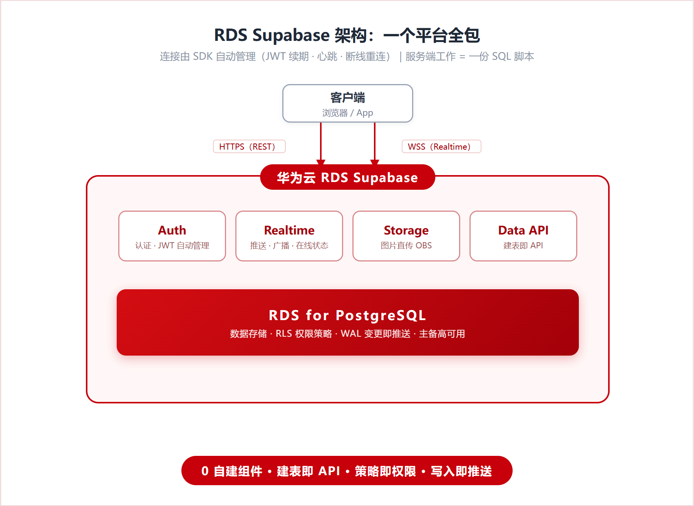

# RDS Supabase Realtime Chat


基于华为云 RDS Supabase 的实时聊天示例应用。消息推送、权限控制、用户认证、文件存储全部由数据库平台承担，前端只有 React 组件，**没有任何后端代码**。



对比传统方案，自建的 WebSocket 网关、鉴权中间件、消息队列、Redis 在线状态服务，在这里分别对应 Realtime、RLS 策略、WAL 推送和 Presence（传统架构见 [docs/architecture-traditional.png](docs/architecture-traditional.png)）。

## 功能

| 能力 | 实现方式 |
| --- | --- |
| 单聊 / 群聊 | rooms + room_members 数据模型，幂等创建 |
| 消息实时推送 | Realtime postgres_changes（WAL 变更捕获），毫秒级送达 |
| 正在输入提示 | Broadcast 瞬态信号，不落库 |
| 在线成员展示 | Presence 状态跟踪 |
| 图片消息 | Storage（对接华为云 OBS） |
| 用户认证 | Auth 邮箱登录，JWT 自动管理 |
| 数据安全隔离 | RLS 行级安全策略，数据库层强制 |

## 安全模型

权限规则写在数据库里（RLS 策略），所有数据出口一起生效，包括页面查询、REST API 和 Realtime 推送。消息读取限制为房间成员，发送时校验 `sender_id = auth.uid()` 防止冒充。已实测验证：第三方账号携带合法 JWT 直连 API 查询他人房间，返回空数组。

`sql/init.sql` 中的 `is_room_member` 函数用于规避 RLS 策略自引用递归，`rooms_creator_select` 策略用于解决 PostgREST `INSERT ... RETURNING` 返回行问题，相关说明见最佳实践文档。

## 快速开始

完整搭建步骤参见华为云最佳实践[《基于华为云RDS Supabase构建实时聊天应用》](https://support.huaweicloud.com/bestpractice-rds-pg/rds_pg_ai_0000.html)。

本地三步即可运行：

```bash
# 1. 在 RDS Supabase Studio 的 SQL Editor 中执行 sql/init.sql
# 2. 复制并填写环境变量
cp .env.example .env    # 填入 Project URL 和 Anon Key
# 3. 安装依赖并启动
npm install && npm run dev
```

## 前提条件

- 已创建 RDS Supabase 应用（公测期间免费）。操作指引参见 [RDS Supabase 应用介绍](https://support.huaweicloud.com/usermanual-rds-pg/rds_supabase_01.html)。
- 本地已安装 Node.js 18 及以上版本。

## 搭建步骤

以下为详细步骤，与最佳实践文档一致。

### 1. 初始化数据库

在 RDS Supabase Studio 的 **SQL Editor** 中执行 `sql/init.sql` 的全部内容，一次性完成：

- 业务表创建（profiles / rooms / room_members / messages）
- 注册触发器（新用户自动创建资料）
- RLS 策略（含 `is_room_member` 安全函数，规避策略递归）
- Realtime 配置（publication + REPLICA IDENTITY FULL）
- Storage 附件桶（chat-attachments）

脚本幂等，可重复执行。

### 2. 获取项目凭据

在 Supabase 应用的 **设置 → API** 页面记录：

- **Project URL**
- **Anon Key**

### 3. 配置并启动前端

```bash
# 复制环境变量模板并填入上述凭据
cp .env.example .env

npm install
npm run dev
```

浏览器打开 `http://localhost:5173`。

> **可选（测试环境）**：为简化注册流程，可在 Studio 的 **Authentication → Providers → Email** 中临时关闭 **Confirm email**。正式环境请保持开启或接入邮件服务。

## 端到端验证清单

建议准备两个账号（两个浏览器窗口，其一使用无痕模式以保证独立会话）：

| # | 操作 | 预期结果 |
| --- | --- | --- |
| 1 | 注册两个账号 | 注册后自动进入聊天页，顶栏显示用户名（触发器生效） |
| 2 | 账号 A 单击 **+**，在「单聊」页选择账号 B | 双方会话列表出现新会话（B 侧实时刷新，无需手动重载） |
| 3 | A 发送文本消息 | B 不刷新页面即时收到；A 自己也收到推送 |
| 4 | A 单击 🖼 发送图片 | 图片上传后双方实时展示（走 Storage/OBS） |
| 5 | A 在输入框打字 | B 侧输入框上方出现「A 正在输入」+ 跳动圆点，停止约 4 秒后消失 |
| 6 | 观察聊天窗口头部 | 显示当前在线成员（Presence） |
| 7 | 刷新浏览器 | 历史消息从数据库重新加载，会话保持登录态 |
| 8 | **验证 RLS**：注册第三个账号 C 登录 | C 的会话列表为空——看不到 A/B 的房间与任何消息 |

步骤 8 是安全模型的关键验证：Realtime 下发消息前会对每位订阅者单独执行 `messages` 表的 RLS 检查，非成员收不到任何推送。

> **测试「正在输入」的常见误区**：该提示**仅在两个不同账号之间显示**。若用同一账号开两个标签页测试，双方互不可见（产品逻辑：不给自己显示"正在输入"，代码中按 `user_id` 过滤）。正确测法：两个不同账号各自登录（其中一个用无痕窗口），双方都停留在同一会话的聊天窗口中，任一方打字，另一方即可看到提示。

## 常见问题

| 现象 | 原因与解决 |
| --- | --- |
| 报错 `infinite recursion detected in policy` | 策略自引用，用 SECURITY DEFINER 函数（`is_room_member`）打破递归 |
| 消息写入了但收不到推送 | 表未加入 `supabase_realtime` publication，或未设置 `REPLICA IDENTITY FULL`；可在 Studio 的 Realtime 页面检查表监听与连接监控 |
| 实时消息的用户名显示异常 | CDC 事件不含嵌套关联，示例已预载 `profiles` 映射表，请确认代码为最新版本 |
| 订阅回调报权限错误 | 当前用户不是房间成员，RLS 拦截，属预期安全行为 |
| 图片发送失败 | 检查 `chat-attachments` 桶与 `storage.objects` 上传策略是否存在 |
| 刷新页面后会话丢失 | 确认客户端初始化时开启 `persistSession`，SDK 会自动恢复会话并续期 JWT |
| 「正在输入」不显示 | 需两个不同账号同时停留在同一聊天窗口（见上方测试误区说明） |
| 连接频繁断开 | SDK 每 30 秒自动心跳保活；高并发场景请关注 Realtime 的连接数配额 |

## 项目结构

```
├── sql/init.sql              # 数据库初始化脚本（幂等，可重复执行）
└── src/
    ├── lib/supabase.ts       # Supabase 客户端（会话持久化/自动续期）
    ├── lib/auth.tsx          # 认证上下文
    └── components/
        ├── Auth.tsx          # 登录/注册
        ├── ChatApp.tsx       # 主布局
        ├── RoomList.tsx      # 会话列表（订阅 room_members 实时刷新）
        ├── ChatWindow.tsx    # 聊天窗口（消息/正在输入/在线状态/图片）
        └── CreateRoomModal.tsx # 新建单聊/群聊
```

## License

[Apache-2.0](LICENSE)
